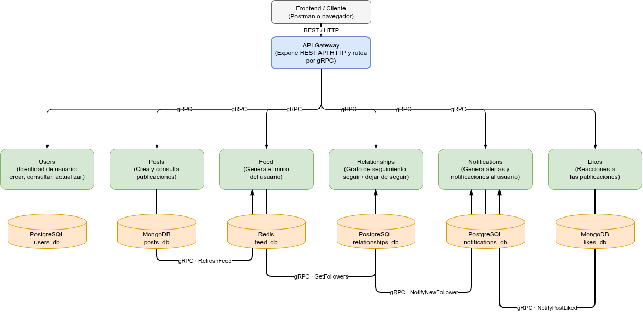

# 1. Descripción del sistema

**Kite** es una red social mínima construida como un sistema de microservicios.
El sistema permite a una persona **crear su cuenta y su perfil**, **seguir a otras
personas**, **publicar contenido**, **consultar el muro de quienes sigue**,
**dar y quitar likes** y **recibir y gestionar notificaciones** cuando alguien
comienza a seguirla o le gusta una publicación suya.

Kite está pensada para dos clases de consumidores:

- **Personas usuarias** (a través de un cliente: aplicación, navegador o
  herramientas como `curl` o Postman), que ejercen las operaciones de negocio:
  crear cuenta, editar perfil, seguir y dejar de seguir, consultar seguidores,
  publicar, leer el muro, reaccionar y revisar su bandeja de alertas.
- **Clientes integradores** (un futuro frontend u otra aplicación), que consumen
  la API REST del sistema programáticamente.

El objetivo de esta primera entrega es demostrar una arquitectura de
microservicios coherente y funcional de extremo a extremo sobre un dominio con
suficiente riqueza de relaciones entre entidades. El alcance incluye la
identidad, el grafo de seguimiento, las notificaciones, las publicaciones, el
muro por usuario y los likes: seis responsabilidades en cinco servicios de
negocio más el gateway (ver sección 10). La autenticación queda fuera del
alcance: la identidad del solicitante se declara en un encabezado, según se
justifica en la sección 6.

El rasgo arquitectónico que atraviesa todo el sistema es que hay **una sola
superficie externa**: un **API Gateway** que habla HTTP/REST hacia afuera y gRPC
hacia adentro. Ningún servicio de negocio es alcanzable desde fuera de la red de
Docker.
Cada servicio es **dueño exclusivo de su propia base de datos** y nunca lee la de
otro: cuando necesita datos ajenos, se los pide por gRPC al servicio que los
posee, o el gateway los **agrega** en una sola respuesta.

---

# 2. Diagrama de arquitectura



**Convenciones del diagrama.** Las flechas entre servicios indican la dirección de
la llamada y el protocolo utilizado (todas entre servicios son **gRPC**; la única
entrada externa es **REST/HTTP**). Las flechas hacia una base de datos son accesos
**locales** del servicio dueño a su propia base, no comunicaciones entre servicios:
no existe ninguna flecha de servicio a servicio que atraviese una base de datos.

| Servicio | Lenguaje | Base de datos | Responsabilidad | Puerto | ¿Expuesto al exterior? |
| :--- | :--- | :--- | :--- | :--- | :--- |
| **API Gateway** | Go | — | Única superficie REST; traduce a gRPC y **agrega** lecturas | 8080 | **Sí** (único puerto publicado) |
| **Users** | Go | PostgreSQL `users_db` | Identidad: crear, consultar y editar usuarios | 50051 | No |
| **Relationships** | Go | PostgreSQL `relationships_db` | Grafo de seguimiento | 50052 | No |
| **Notifications** | Python | PostgreSQL `notifications_db` | Alertas y bandeja del usuario | 50053 | No |
| **Posts** | Go | MongoDB `posts_db` | Publicaciones y consulta por identificador | 50054 | No |
| **Feed** | Go | Redis `feed_db` | Muro por usuario (ordenado por tiempo) | 50055 | No |
| **Likes** | Go | MongoDB `likes_db` | Reacciones sobre una publicación | 50056 | No |

**Aislamiento de red.** En `docker-compose.yml` los servicios y las bases viven en
una red `backend` **interna** (sin puertos publicados y sin salida al exterior), y
únicamente el API Gateway se conecta además a la red `frontend`, la única publicada
al host. El resultado, verificable, es que solo el puerto 8080 responde desde fuera
de Docker: los puertos 50051–50056 están cerrados al host.

---

# 3. Servicios y contratos

El contrato interno es **Protobuf sobre gRPC**; los `.proto` y los stubs generados
se versionan dentro de cada servicio (y el gateway mantiene una copia de cada
contrato de cliente), de modo que cada imagen se construye desde su propio
contexto sin dependencias externas.

## 3.1 Servicio Users (Go — `users_db`)

Administra la entidad **Usuario**. El `user_id` es un UUID generado por la base de
datos del servicio, nunca por el cliente.

| Método gRPC | Entrada | Salida | Notas |
| :--- | :--- | :--- | :--- |
| `CreateUser` | `username`, `email`, `display_name` | `User` completo | Valida formato y unicidad |
| `GetUser` | `user_id` | `User` completo | `NotFound` si no existe |
| `UpdateUser` | `user_id`, `display_name?`, `email?` | `User` completo | Parche: solo modifica lo enviado |

La entidad `User` expone `user_id`, `username`, `email`, `display_name`,
`created_at` y `updated_at`. El `username` es el **identificador estable** y no se
edita.

## 3.2 Servicio Relationships (Go — `relationships_db`)

Administra el **grafo de seguimiento**: quién sigue a quién. Es la única fuente de
verdad de esa relación.

| Método gRPC | Entrada | Salida | Notas |
| :--- | :--- | :--- | :--- |
| `FollowUser` | `follower_id`, `followee_id` | `Follow` | Idempotente; rechaza el auto-seguimiento |
| `UnfollowUser` | `follower_id`, `followee_id` | (vacío) | `NotFound` si la arista no existía |
| `GetFollowers` | `user_id`, `limit`, `offset` | `user_ids`, `total` | Paginado |
| `GetFollowing` | `user_id`, `limit`, `offset` | `user_ids`, `total` | Paginado |

`FollowUser` invoca `Notifications.NotifyNewFollower` **solo cuando la arista es
nueva** (una repetición idempotente no vuelve a notificar), y lo hace con
**degradación elegante**: si Notifications está caído, el seguimiento se persiste
igual y solo se registra una advertencia.

## 3.3 Servicio Notifications (Python — `notifications_db`)

Recibe los **dos disparadores** del sistema y expone la bandeja del usuario.

| Método gRPC | Entrada | Salida | Notas |
| :--- | :--- | :--- | :--- |
| `NotifyNewFollower` | `follower_id`, `followee_id` | `Notification` | Disparado por Relationships |
| `NotifyPostLiked` | `post_id`, `liker_id`, `post_author_id` | `Notification` | Disparado por Likes |
| `GetUnreadNotifications` | `user_id`, `limit`, `offset` | `notifications`, `total` | Paginado |
| `MarkAsRead` | `user_id`, `notification_id` | `Notification` | `NotFound` si no es del usuario |

El tipo de notificación es un **enum** cerrado del contrato
(`NEW_FOLLOWER`, `LIKE`), y `post_id` solo tiene valor en las de tipo `LIKE`.

## 3.4 Servicio Posts (Go — `posts_db`)

Administra las **publicaciones**: quién publicó, cuándo y qué. El `post_id` es un
`ObjectId` de MongoDB generado por la base. El autor se recibe como referencia
lógica (`user_id`), sin consultar a Users: el gateway ya conoce el autor.

| Método gRPC | Entrada | Salida | Notas |
| :--- | :--- | :--- | :--- |
| `CreatePost` | `user_id`, `content` | `Post` completo | Valida longitud; **dispara** `Feed.RefreshFeed` |
| `GetPost` | `post_id` | `Post` completo | `NotFound` si no existe |
| `GetPostsByIds` | `post_ids` | `posts` | Para el gateway al armar el muro |
| `GetPostsByUser` | `user_id`, `limit`, `offset` | `posts`, `total` | Paginado |
| `DeletePost` | `post_id`, `user_id` | `status` | Solo el autor; `NotFound` si no existe |

`CreatePost` invoca `Feed.RefreshFeed(author, post)` **después de persistir**, con
degradación elegante: si Feed está caído, la publicación se conserva y solo se
registra una advertencia. No hay llamada a Notifications: un like sin destinatario
no es notificación.

## 3.5 Servicio Feed (Go — `feed_db`)

Administra el **muro por usuario**: un orden de publicaciones por persona,
mantenido en un **sorted set de Redis** cuyo *score* es el instante de la
publicación. Es la única pieza del sistema que usa Redis, elegida por la
operación central: mantener una lista ordenada por tiempo e insertar en O(log n).

| Método gRPC | Entrada | Salida | Notas |
| :--- | :--- | :--- | :--- |
| `RefreshFeed` | `author_id`, `post_id` | `status` | Disparado por Posts; reparte el post en el autor y sus seguidores |
| `GetUserFeed` | `user_id`, `limit`, `offset` | `post_ids`, `total`, `last_updated` | `total` = `ZCARD` del muro |

`RefreshFeed` pide a **Relationships** los seguidores del autor (con degradación:
sin esa lista, el post entra solo al muro del autor) y hace un `ZADD` por cada
muro. El servicio **no resuelve contenido**: devuelve identificadores, y el
gateway arma la respuesta pidiendo los posts a Posts (ver sección 5, UC-7). El
`last_updated` es el RFC3339 del post más reciente del muro.

## 3.6 Servicio Likes (Go — `likes_db`)

Administra las **reacciones**: una por persona y por publicación. El `like_id` es
un `ObjectId` de MongoDB.

| Método gRPC | Entrada | Salida | Notas |
| :--- | :--- | :--- | :--- |
| `LikePost` | `post_id`, `user_id`, `post_author_id` | `like_id`, `status` | Idempotente; **dispara** `NotifyPostLiked` si es nuevo |
| `UnlikePost` | `post_id`, `user_id` | `status` | `NotFound` si no existía |
| `GetPostLikes` | `post_id`, `limit`, `offset` | `likes`, `total` | Paginado |
| `HasLiked` | `post_id`, `user_id` | `liked` | Consulta puntual |

`post_author_id` lo resuelve el **gateway** (con `Posts.GetPost`) antes de la
llamada: así Likes **no depende de Posts** y el contrato queda abierto. La
idempotencia la garantiza un **índice único** sobre `(post_id, user_id)`: la
repetición no inserta ni vuelve a notificar (`status=already_liked`).
`LikePost` invoca **`Notifications.NotifyPostLiked` solo cuando el like es
nuevo**, con la misma degradación elegante que Relationships: si Notifications
está caído, el like se persiste y solo se advierte. **Notifications filtra** el
caso de que el destinatario sea el propio autor: no tiene sentido notificarse a
sí mismo, y la regla vive en quien conoce la bandeja, no en Likes.

## 3.7 API Gateway (Go — REST → gRPC)

Es la **única** superficie externa. Traduce cada petición a una o más llamadas
gRPC. **No contiene reglas de negocio**: esas viven en los microservicios; el
gateway solo transporta, valida la forma de la petición y **agrega**.

| Método REST | Delega en | Notas |
| :--- | :--- | :--- |
| `GET /` | (local) | Índice de la API: mapa de rutas y del encabezado `X-User-Id` |
| `POST /users` | `Users.CreateUser` | `201 Created` |
| `GET /users/{user_id}` | `Users.GetUser` | `200` |
| `PATCH /users/{user_id}` | `Users.UpdateUser` | Parche parcial |
| `POST /users/{user_id}/follow` | `Relationships.FollowUser` | Identidad en `X-User-Id` |
| `DELETE /users/{user_id}/follow` | `Relationships.UnfollowUser` | `204 No Content` |
| `GET /users/{user_id}/followers` | `Relationships.GetFollowers` | `limit`, `offset` |
| `GET /users/{user_id}/following` | `Relationships.GetFollowing` | `limit`, `offset` |
| `GET /notifications` | **Agrega** `Notifications` + `Users` | Ver sección 5, UC-4 |
| `POST /notifications/{notification_id}/read` | `Notifications.MarkAsRead` | |
| `POST /posts` | `Posts.CreatePost` | `201 Created`; el autor va en `X-User-Id` |
| `GET /posts/{post_id}` | `Posts.GetPost` | `200` |
| `POST /posts/{post_id}/like` | **Resuelve** `Posts.GetPost`, luego `Likes.LikePost` | `201`; `404` si el post no existe |
| `DELETE /posts/{post_id}/like` | `Likes.UnlikePost` | `204 No Content` |
| `GET /feed` | **Agrega** `Feed` + `Posts` | Ver sección 5, UC-7 |
| `GET /health` | (local) | Estado del gateway y de sus backends |

Las operaciones que actúan **en nombre de una persona** reciben su identidad en el
encabezado **`X-User-Id`**. La raíz (`GET /`) devuelve un índice de la API, y el
gateway tolera una barra final de más (`/users/{id}/`) reescribiendo el camino
internamente, para que la URL que se teclea a mano nunca dependa de un detalle del
enrutador.

---

# 4. Modelo de datos

Cada servicio posee su propia base y aplica sus migraciones al arrancar (embebidas
en el binario o en el paquete, versionadas de forma incremental y solo hacia
adelante).

**`users_db` · tabla `users`**

| Columna | Tipo | Restricción |
| :--- | :--- | :--- |
| `user_id` | UUID | PK, `DEFAULT gen_random_uuid()` |
| `username` | TEXT | `UNIQUE`, `NOT NULL` |
| `email` | TEXT | `UNIQUE`, `NOT NULL`, indexado |
| `display_name` | TEXT | `NOT NULL` |
| `created_at` | TIMESTAMPTZ | `NOT NULL`, `DEFAULT now()` |
| `updated_at` | TIMESTAMPTZ | `NOT NULL`, `DEFAULT now()` |

**`relationships_db` · tabla `follows`**

| Columna | Tipo | Restricción |
| :--- | :--- | :--- |
| `follower_id` | UUID | PK compuesta, `NOT NULL` |
| `followee_id` | UUID | PK compuesta, `NOT NULL`, indexado |
| `created_at` | TIMESTAMPTZ | `NOT NULL`, `DEFAULT now()` |

Restricción `CHECK (follower_id <> followee_id)` e índice sobre `followee_id`.

**`notifications_db` · tabla `notifications`**

| Columna | Tipo | Restricción |
| :--- | :--- | :--- |
| `id` | UUID | PK, `DEFAULT gen_random_uuid()` |
| `user_id` | UUID | `NOT NULL` (destinatario) |
| `type` | VARCHAR(32) | `NOT NULL`, `CHECK IN ('LIKE','NEW_FOLLOWER')` |
| `source_user_id` | UUID | `NOT NULL` (quien originó la acción) |
| `post_id` | TEXT | `CHECK`: obligatorio en `LIKE`, nulo en `NEW_FOLLOWER` |
| `is_read` | BOOLEAN | `NOT NULL`, `DEFAULT false` |
| `created_at` | TIMESTAMPTZ | `NOT NULL`, `DEFAULT now()` |

Índice `(user_id, is_read, created_at DESC)` para la bandeja sin leer.

**`posts_db` · colección `posts` (MongoDB)**

| Campo | Tipo | Notas |
| :--- | :--- | :--- |
| `_id` | `ObjectId` | PK; genera el `post_id` |
| `user_id` | STRING | Referencia lógica al autor (UUID de Users) |
| `content` | STRING | Texto de la publicación |
| `created_at` | DATE | Instante de creación (UTC) |

Índices: `(user_id, created_at DESC)` para el historial de un autor y
`(created_at DESC)` para el orden global.

**`likes_db` · colección `likes` (MongoDB)**

| Campo | Tipo | Notas |
| :--- | :--- | :--- |
| `_id` | `ObjectId` | PK; genera el `like_id` |
| `post_id` | STRING | Referencia lógica a la publicación |
| `user_id` | STRING | Referencia lógica a quien reacciona |
| `created_at` | DATE | Instante de la reacción (UTC) |

Índice **único** `(post_id, user_id)`: es la garantía de que una persona no
reactiona dos veces la misma publicación, y la base de la idempotencia de
`LikePost`. Índice `(post_id, created_at DESC)` para listar reacciones.

**`feed_db` · muros (Redis)**

Cada muro es un **sorted set** en la clave `feed:{user_id}`: el miembro es el
`post_id` y el *score* es el instante de la publicación. Las operaciones
centrales son `ZADD` (insertar en el muro del autor y el de cada seguidor),
`ZREVRANGEBYSCORE` (página del muro, de más reciente a más antiguo) y `ZCARD`
(total real, independiente de la página). No es una base relacional ni un
documento: es una estructura de ordenamiento, y por eso vive en Redis.

**Entidades de dominio persistidas.** El sistema cubre cinco entidades con
persistencia real (`User`, `Follow`, `Notification`, `Post` y `Like`), más los
muros de Redis, muy por encima del mínimo de dos exigido por la rúbrica. Nada
relevante vive en memoria: las bases se guardan en **volúmenes** de Docker, y se
verificó que los datos sobreviven a un `docker compose down` seguido de `up`.

**Referencias lógicas, no claves foráneas cruzadas.** `follows.follower_id`,
`follows.followee_id`, `notifications.user_id`, `notifications.source_user_id`,
`notifications.post_id`, `posts.user_id`, `likes.post_id` y `likes.user_id`
**apuntan** a datos de otros servicios, pero sus bases **no** declaran claves
foráneas hacia ellos: una base que pertenece a otro servicio no podría verificar
esa existencia, y declararla acoplaría los esquemas. Las reglas de dominio que sí
son locales (unicidad de `username` y `email`, no seguirse a sí mismo, forma de
la notificación, una reacción por persona y publicación) se refuerzan con
restricciones reales **en la base**, como defensa en profundidad además de la
validación del servicio.

---

# 5. Casos de uso

Cada caso se describe en **dos capas**: (1) la vista de la persona usuaria y el
resultado esperado, y (2) el detalle técnico, con el recorrido, el orden de
comunicación entre servicios y dónde queda persistido.

## UC-1 · Crear cuenta y editar el perfil

**Capa 1 (vista de usuario).** Una persona nueva se registra indicando su
`username`, su `email` y su nombre visible. El sistema le asigna un
identificador y la deja lista para operar. Más tarde ajusta su nombre visible sin
cambiar su `username` (que es su identificador estable). *Resultado esperado:* la
cuenta queda creada y el perfil refleja los cambios.

**Capa 2 (detalle técnico).**

1. `POST /users` llega al gateway con el cuerpo JSON.
2. El gateway delega en **`Users.CreateUser`** por gRPC (una sola llamada).
3. Users valida el formato (`username` de 3 a 50 caracteres, `email` con forma de
   email, `display_name` de 1 a 80) y normaliza los espacios.
4. Persiste con `INSERT INTO users ... RETURNING`; la base genera el `user_id`.
   Si viola `users_username_key` o `users_email_key`, el store traduce el error a
   `AlreadyExists`.
5. El usuario vuelve completo y el gateway responde **`201 Created`**.

Para la edición: `PATCH /users/{user_id}` → **`Users.UpdateUser`** con solo los
campos enviados → `UPDATE` sobre `users` (que refresca `updated_at`) → `200`. El
`username` no forma parte del mensaje de actualización: es inmutable.

*Persistencia:* `users_db · users`.

## UC-2 · Seguir a otra persona y generar la alerta

**Capa 1 (vista de usuario).** Alicia sigue a Bernardo. Bernardo recibe una
notificación de **nuevo seguidor** que, además del identificador, muestra **quién**
la originó. *Resultado esperado:* el seguimiento queda registrado y Bernardo ve la
alerta.

**Capa 2 (detalle técnico).** Este caso cruza **dos servicios y dos bases**, con
una llamada de servicio a servicio (`Relationships → Notifications`) que se
repite en el patrón de los likes (UC-6).

1. `POST /users/{bob}/follow` llega al gateway con el encabezado
   `X-User-Id: alice`. El `{user_id}` de la ruta es **a quién** se sigue; **quién**
   sigue viene en el encabezado.
2. El gateway delega en **`Relationships.FollowUser(alice, bob)`** por gRPC.
3. Relationships valida que no sea un auto-seguimiento y hace
   `INSERT INTO follows ... ON CONFLICT DO NOTHING RETURNING`. **La arista nueva se
   detecta por el `RETURNING`:** si no devuelve fila, el seguimiento ya existía.
4. **Solo si la arista es nueva**, Relationships llama a
   **`Notifications.NotifyNewFollower(alice, bob)`** por gRPC (llamada 2→3).
   Notifications persiste en su propia base
   (`INSERT INTO notifications ... type='NEW_FOLLOWER'`).
5. Si Notifications estuviera caído, **el paso 4 se degrada**: el seguimiento ya
   está persistido y solo se registra una advertencia; la respuesta al usuario sigue
   siendo un éxito.
6. El gateway responde **`201 Created`** con la arista.

*Persistencia:* `relationships_db · follows` **y** `notifications_db ·
notifications`. Orden de comunicación: cliente → Gateway → Relationships →
Notifications.

## UC-3 · Consultar el grafo de seguidores (paginado)

**Capa 1 (vista de usuario).** Se consulta **quién sigue** a una persona y **a
quién sigue** esa persona, por páginas. *Resultado esperado:* la lista de
identificadores de la página pedida y el total, para poder mostrar "N seguidores".

**Capa 2 (detalle técnico).**

1. `GET /users/{id}/followers?limit=20&offset=0` llega al gateway.
2. El gateway delega en **`Relationships.GetFollowers(user_id, limit, offset)`**.
3. Relationships ejecuta dos consultas sobre su base: la página
   (`SELECT follower_id ... WHERE followee_id=$1 ORDER BY created_at DESC LIMIT $2
   OFFSET $3`, cubierta por `idx_follows_followee`) y el total
   (`SELECT count(*) ...`). El `total` es independiente de la página.
4. Devuelve `user_ids` y `total`; el gateway responde **`200`**.

`GET /users/{id}/following` es simétrico, apoyado en la clave primaria compuesta.
*Persistencia:* `relationships_db · follows`. **Nótese que Relationships solo
conoce identificadores**: no guarda perfiles. Si un cliente necesita los nombres,
sería el gateway quien los agregaría pidiéndolos a Users, exactamente con el mismo
patrón que en UC-4 (una sola llamada de servicio por identificador distinto).

## UC-4 · Ver la bandeja agregada y marcar como leída

**Capa 1 (vista de usuario).** Bernardo abre sus notificaciones y ve las alertas
**sin leer**, cada una con **quién** la originó, con un único llamado. Luego marca
una como leída y desaparece de la bandeja. *Resultado esperado:* una bandeja
completa y autocontenida, y la alerta marcada.

**Capa 2 (detalle técnico).** Este es el caso donde el **gateway agrega**.

1. `GET /notifications` llega con el encabezado `X-User-Id: bob`.
2. El gateway delega en **`Notifications.GetUnreadNotifications(bob, limit,
   offset)`** (llamada 1).
3. Notifications consulta su índice `(user_id, is_read, created_at DESC)` y
   devuelve las alertas sin leer con su `total`.
4. El gateway reúne los `source_user_id` **distintos** y, **en paralelo**, llama a
   **`Users.GetUser`** una sola vez por cada uno (llamada 2..n) para **hidratar** el
   emisor.
5. Combina todo en una única respuesta `200` con `notifications` y `total`, donde
   cada alerta incluye su `source_user`.
6. Para marcar como leída: `POST /notifications/{id}/read` → **`MarkAsRead`** →
   `UPDATE notifications SET is_read=true WHERE id=$1 AND user_id=$2` → `200`.

*Persistencia:* `notifications_db · notifications`, enriquecida con lectura de
`users_db` a través de su servicio dueño. **Ningún servicio lee la base del otro:**
la agregación ocurre en el gateway, y un servicio caído solo degrada el campo
accesorio (ver sección 7), nunca tumba la respuesta completa.

## UC-5 · Publicar y enriquecer el muro del autor

**Capa 1 (vista de usuario).** Alicia escribe una publicación y aparece de
inmediato en su propio muro. *Resultado esperado:* el post queda persistido y el
muro del autor lo contiene.

**Capa 2 (detalle técnico).** Este es el flujo que pone a Posts y Feed a
trabajar juntos, sin tocar a Notifications.

1. `POST /posts` llega al gateway con `X-User-Id: alice` y el cuerpo
   `{"content":"…"}`.
2. El gateway delega en **`Posts.CreatePost(alice, content)`** por gRPC.
3. Posts valida la longitud del contenido y persiste el documento en su propia
   colección (`_id` autogenerado, `user_id`, `content`, `created_at`).
4. **Solo después de persistir**, Posts llama a **`Feed.RefreshFeed(alice,
   post_id)`** por gRPC (llamada 2→3). Feed pide a Relationships los seguidores
   de Alice y hace un `ZADD` del `post_id` en el muro de Alice y en el de cada
   uno de ellos, con el instante como *score*.
5. Si Feed estuviera caído, **el paso 4 se degrada**: el post ya está persistido
   y solo se registra una advertencia; la respuesta sigue siendo un éxito.
6. El gateway responde **`201 Created`** con el post completo.

*Persistencia:* `posts_db · posts` y `feed_db · feed:{user_id}` (un zset por
persona afectada). Orden de comunicación: cliente → Gateway → Posts → Feed →
Relationships.

## UC-6 · Dar like y notificar al autor

**Capa 1 (vista de usuario).** Alicia le da like a una publicación de Bernardo.
Bernardo recibe una notificación de **like** que muestra quién reaccionó y sobre
qué publicación. Repetir el like no duplica nada. *Resultado esperado:* la
reacción queda registrada y Bernardo ve la alerta.

**Capa 2 (detalle técnico).** Es el segundo flujo con llamada de servicio a
servicio (`Likes → Notifications`) y con el mismo patrón de degradación.

1. `POST /posts/{post_id}/like` llega con `X-User-Id: alice`.
2. El gateway **resuelve primero el autor** con `Posts.GetPost(post_id)`
   (llamada 1): con ese `user_id` ya no necesita volver a preguntar y Likes
   sigue sin depender de Posts. Si el post no existe responde `404` y **no**
   llama a Likes.
3. El gateway delega en **`Likes.LikePost(post_id, alice, author)`** (llamada 2).
4. Likes inserta el documento en su colección. El **índice único**
   `(post_id, user_id)` es lo que hace idempotente la operación: si el like ya
   existía, no inserta y devuelve `status=already_liked` **sin notificar**.
5. **Solo si el like es nuevo**, Likes llama a
   **`Notifications.NotifyPostLiked(post_id, alice, bernardo)`** (llamada 3).
   Notifications persiste `type='LIKE'` **y filtra el caso** de que el
   destinatario sea el propio autor: notificarse a uno mismo no tiene sentido, y
   esa regla vive en quien conoce la bandeja.
6. Si Notifications estuviera caído, **el paso 5 se degrada**: el like ya está
   persistido y solo se advierte.
7. El gateway responde **`201 Created`** con el like.

*Persistencia:* `likes_db · likes` y `notifications_db · notifications`. Orden:
cliente → Gateway → Posts → Likes → Notifications.

## UC-7 · Ver el muro agregado

**Capa 1 (vista de usuario).** Alicia abre su muro y ve, de más reciente a más
antiguo, las publicaciones de quienes sigue (y las suyas propias), con un total.
*Resultado esperado:* un muro completo y autocontenido con un único llamado.

**Capa 2 (detalle técnico).** Este es el segundo caso de **agregación en el
gateway** (junto con UC-4).

1. `GET /feed?limit=20&offset=0` llega con `X-User-Id: alice`.
2. El gateway delega en **`Feed.GetUserFeed(alice, limit, offset)`**: devuelve
   una página de `post_ids`, el `total` real del muro (`ZCARD`, independiente de
   la página) y el `last_updated`.
3. El gateway reúne los `post_ids` y pide los documentos a
   **`Posts.GetPostsByIds(ids)`** en una sola llamada.
4. Reordena los posts devueltos **según el orden del muro** (por si el servicio
   los devuelve en otro orden) y **omite con una advertencia** los identificadores
   cuyo post ya no existe: un post borrado no debe tumbar el muro.
5. Combina todo en una única respuesta `200` con `posts`, `total` y
   `last_updated`; si el muro está vacío, `posts` es **`[]`**, no `null`.

*Persistencia:* `feed_db · feed:{user_id}` (identificadores) enriquecida con
`posts_db · posts` a través de su servicio dueño. **Ningún servicio lee la base
del otro:** la agregación ocurre en el gateway, y un servicio caído degrada el
muro completo a `503` (sin feed no hay orden, y un muro desordenado sería peor
que ninguno).

## Otros flujos cubiertos

- **Dejar de seguir** (UC-2 inverso): `DELETE /users/{id}/follow` →
  `Relationships.UnfollowUser` → `DELETE FROM follows` → `204`; `404` si la arista
  no existía.
- **Consultar un perfil**: `GET /users/{id}` → `Users.GetUser` → `200`/`404`.
- **Ver una publicación**: `GET /posts/{id}` → `Posts.GetPost` → `200`/`404`.
- **Quitar like** (UC-6 inverso): `DELETE /posts/{id}/like` →
  `Likes.UnlikePost` → `204`; `404` si la reacción no existía.

---

# 6. Decisiones técnicas y trade-offs

Las decisiones estructurantes del sistema (6.1, 6.3, 6.6, 6.10 y 6.13) se
desglosan con su contexto, sus ganancias, sus pérdidas y las alternativas que
se descartaron. El resto se explica en prosa, pero también deja explícito qué
se gana, qué se pierde y qué se dejó de lado y por qué.

### 6.1 Límites de los servicios: por qué cada responsabilidad es su propio servicio

**Contexto.** El dominio tiene seis responsabilidades con **ciclos de vida y
patrones de acceso distintos**: la identidad (lecturas por clave, escrituras con
unicidad estricta), el grafo de seguimiento (relaciones N:M de alta escritura y
lecturas paginadas), las alertas (escrituras disparadas por otros servicios y
lecturas por bandeja), las publicaciones (documentos con contenido libre), el
muro por usuario (orden de identificadores por tiempo) y los likes (reacciones
con unicidad por par usuario-publicación).

**Decisión.** Un servicio por responsabilidad, cada uno con su propia base.

**Ganancias.** Cada uno tiene **cohesión alta** y un único motivo para cambiar; se
escalan y despliegan por separado (un pico en el grafo no degrada la identidad); y
el **fallo se aísla**: si Notifications cae, seguir a alguien y dar likes siguen
funcionando.

**Pérdidas.** Seis despliegues, seis bases que mantener y **sin transacciones
cruzadas**: la consistencia entre el seguimiento y su alerta, o entre un like y su
notificación, es *eventual*, no atómica.

**Alternativas descartadas.** Un **monolito modular** (más simple y con
transacciones, pero no demuestra la arquitectura pedida y acopla todo el
despliegue); **partir por conveniencia de trabajo** (rechazado explícitamente: la
división debe responder a cohesión, no a repartirse tareas); y **un servicio de
"actividad" continuo**, descartado porque diluye el límite de "notificaciones".

### 6.2 Una base de datos por servicio (y no una base compartida)

Cada servicio tiene su **propia base**, con su propia instancia y credenciales,
y ninguno consulta la base de otro. Es lo que hace real la independencia: cada
servicio evoluciona su esquema sin coordinar, un fallo de una base no arrastra
a las demás, y se elimina el *coupling* negativo que la rúbrica penaliza
(servicios que comparten esquema quedan atados por él).

El precio es que **no hay JOINs entre servicios** ni transacciones
distribuidas: hay que agregar en el gateway y aceptar duplicación de
identificadores, además de mantener más infraestructura (seis instancias en vez
de una). Se descartó **una sola base con varios esquemas** (más cómoda y con
transacciones, pero es exactamente el acoplamiento por base de datos que la
rúbrica declara insuficiente) y **una base con una tabla por servicio** (peor
aún). En el compose se eligió una instancia por servicio en lugar de un único
motor con varias bases, para que la propiedad quede explícita en `docker ps` y
para aislar el fallo; el costo es algo más de memoria, aceptable en el alcance
del laboratorio.

### 6.3 Elección de base por servicio: PostgreSQL, MongoDB y Redis

**Decisión.** Users, Relationships y Notifications usan **PostgreSQL**; Posts y
Likes, **MongoDB**; y Feed, **Redis**.

**Ganancias.** Cada tecnología resuelve con lo que le es natural el problema que
tiene enfrente. Las tres relaciones necesitan lo que una base **relacional** da
gratis y bien: **restricciones** que son reglas de negocio en la base (unicidad de
`username` y `email`, `CHECK` de no auto-seguimiento, `CHECK` de la forma de la
notificación), **clave primaria compuesta** para el grafo (que además impide
seguir dos veces), **transacciones** en cada escritura, `TIMESTAMPTZ`, índices
parciales y `gen_random_uuid()` para generar identificadores sin coordinación.
Publicaciones y likes son **documentos** cuyo contenido y esquema conviene poder
evolucionar sin migraciones, y la unicidad de una reacción por persona y
publicación es un **índice único** de MongoDB. El muro es un **orden por
tiempo** que se consulta por página: el *sorted set* de Redis lo mantiene con
`ZADD`/`ZREVRANGEBYSCORE` y cuenta el total con `ZCARD`.

**Pérdidas.** Tres tecnologías que mantener en el laboratorio; esquema rígido en
PostgreSQL (todo cambio es una migración); y Redis no ofrece consultas
relacionales: el muro solo puede leerse como la estructura en la que fue
escrito.

**Alternativas descartadas.** **MongoDB para las tres relaciones**: el grafo de
seguimiento es *literalmente* una relación N:M con una restricción de unicidad y
otra de no-reflexividad, que es justo el terreno donde un modelo de documentos
obliga a implementar a mano lo que el motor ya garantiza; la identidad exige
unicidad
estricta; y las notificaciones se consultan por bandeja ordenada, algo que un
índice relacional resuelve directamente. **Redis para el muro con listas**:
`LRANGE` recorta pero no pagina por *score* ni da un total barato. **Redis como
caché delante de Postgres** para el feed: introduciría dos fuentes de verdad del
mismo dato sin un protocolo de invalidación claro.

### 6.4 gRPC con Protobuf como comunicación interna (y REST solo en el borde)

REST/HTTP **solo** hacia afuera, en el gateway; gRPC/Protobuf entre todos los
servicios. El contrato es tipado y versionado en un `.proto` que genera stubs:
un cambio incompatible **no compila**, en lugar de descubrirse en producción,
los mensajes tienen sentido de negocio y el transporte es eficiente sobre
HTTP/2.

Lo que se pierde es comodidad de depuración: un `curl` es más inmediato que un
cliente gRPC (aunque los servicios registran *server reflection*, así que
`grpcurl` funciona sin los `.proto`) y un navegador no consume gRPC
directamente, que es justamente para lo que existe el gateway. Entre las
alternativas quedaron **REST entre servicios** (más familiar, pero contratos más
débiles y sin generación de código), **GraphQL** (innecesario aquí) y
**JSON-RPC** (sin tipado fuerte).

### 6.5 Sin broker ni cola de mensajes

Todas las llamadas entre servicios son gRPC directo, sin broker. Esto cumple el
requisito de la entrega (una cola transportando tráfico entre servicios lo
contradiría), evita una pieza de infraestructura que mantener y hace el flujo
tratable: el orden de las llamadas se lee en el código.

A cambio, las llamadas son **síncronas**: el emisor espera y no hay
almacenamiento intermedio que absorba picos. La consecuencia se asume
explícitamente en UC-2 y UC-6: si Notifications está caído cuando alguien sigue
a otro o le da like a una publicación, la alerta no se reintenta, aunque el
seguimiento y el like sí se persisten. Se prefirió un sistema sin dependencias
extra a una garantía de entrega que exigiría *outbox* o una cola.

De las alternativas, **RabbitMQ** entre Posts y Notifications figuraba en un
borrador anterior y se eliminó porque contradecía el requisito de gRPC; el
**patrón outbox con reintentos** se descartó por alcance (añade una tabla de
eventos y un proceso de reenvío que no aporta a lo que evalúa esta entrega) y
quedó anotado como mejora futura.

### 6.6 El API Gateway como único punto de entrada **y** agregador

**Decisión.** El gateway es la única superficie REST y, además, **agrega** en dos
lugares: en `GET /notifications` combina Notifications con Users, y en
`GET /feed` combina Feed con Posts.

**Ganancias.** **Único punto de entrada** (los servicios internos quedan
inaccesibles desde fuera, requisito de la rúbrica); los clientes hacen **una** llamada
en vez de dos o tres y no necesitan conocer la topología; los servicios quedan
**desacoplados** entre sí (es la razón de que **no** exista una llamada
Likes→Posts ni Notifications→Posts: el gateway resuelve esos campos; en
`POST /posts/{id}/like` resuelve el autor del post con Posts y se lo entrega a
Likes ya resuelto).

**Pérdidas.** Un **salto extra** de latencia y un componente que puede volverse un
**punto único de fallo** y un cuello de botella (mitigado: puede escalarse
horizontalmente al ser sin estado; "no guarda nada"). También concentra complejidad:
hay que cuidar que **no** se filtre lógica de negocio hacia él (por eso solo traduce
y agrega).

**Alternativas descartadas.** **Que los clientes consuman gRPC directamente**
(prohibido por el enunciado, y expondría los servicios internos); **un BFF por
tipo de cliente** (sobre-ingeniería para esta entrega).

### 6.7 Diseño del Protobuf

**Cómo quedó el contrato y por qué.** El **tipo de notificación es un `enum`** y no un `string`:
el contrato queda **cerrado** y el compilador rechaza valores inventados (antes era
un `string` que permitía cualquier cosa). Los campos editables de `UpdateUser` son
**`optional`**, que expresa con precisión la semántica de parche ("solo lo
enviado"). Cada operación tiene **su propio mensaje de Request/Response** en lugar
de reutilizar uno genérico: permite que cada uno evolucione sin arrastrar a los
demás. Las fechas usan **`google.protobuf.Timestamp`**. Los identificadores son
`string` en el contrato aunque la base use `UUID`.

**Lo que cuesta cada elección.** Un `enum` exige **actualizar el contrato (y regenerar) para añadir un
tipo**, mientras que un `string` sería más laxo; se prefiere el error temprano.
`optional` añade **presencia explícita** al JSON/binary, con algo más de tamaño.
Muchos mensajes implican **más líneas** de `.proto`, a cambio de compatibilidad.
`Timestamp` no es texto legible, pero es **inequívoco** y portable.

**Alternativas descartadas.** `string type` (acepta basura); un único mensaje
"UserPatch"; fechas como `string` (ambiguas en zona horaria y formato).

### 6.8 Identificadores UUID generados por la base

El `user_id` (y el `id` de notificación) son UUID generados por la base con
`gen_random_uuid()`. Los identificadores no pueden colisionar entre servicios ni
dependen de coordinación; son opacos (no filtran cuántos usuarios hay) y el
cliente no puede fabricar uno válido.

Un UUID ocupa más que un entero y su aleatoriedad penaliza la localidad del
índice, aunque en la práctica se usa UUID v4 y los volúmenes son pequeños. Se
descartó el **autoincremental** (enumerable: un cliente adivina identificadores
ajenos, y colisiona entre servicios), el **identificador generado por el
cliente** (implica confiar en el cliente) y **generarlo siempre en el código del
servicio** (posible, pero se prefirió el valor por defecto de la base para que
ninguna ruta pueda insertar sin identificador).

### 6.9 Migraciones embebidas, incrementales y hacia adelante

Cada servicio lleva sus migraciones **dentro de su artefacto** y las aplica al
arrancar; una migración ya aplicada no se reescribe, se corrige con una nueva.
El servicio queda autocontenido (no necesita una herramienta ni un paso manual),
el arranque es determinista y es seguro ante reintentos. El caso real se dio en
Users: al añadir `display_name` y la unicidad de `username` se creó la
migración **002** en lugar de editar la 001 ya desplegada, rellenando las filas
existentes antes de exigir `NOT NULL`.

Lo que no hay son migraciones reversas (un *rollback* exige escribir una nueva)
y el arranque paga el costo de aplicar lo pendiente. Se descartó una
**herramienta externa** (`golang-migrate`, Atlas), que añadiría otro binario que
versionar, y los **scripts de `initdb` en compose**, que acoplarían el esquema
al compose y romperían el principio de que cada servicio es dueño de su base.

### 6.10 Resiliencia: tiempo límite, errores ordenados, reconexión y degradación

**Decisión.** El gateway usa **conexiones perezosas** (arranca aunque un servicio esté
caído), un **tiempo límite por llamada**, y **traduce cada error gRPC a un código
HTTP con sentido**. Además, cuatro comportamientos de degradación deliberados.

**Ganancias.** La caída de un tercero **no propaga** ("sin colapsar ni crashear", lo
que pide la rúbrica): `GET /notifications` sigue en `200` y solo omite el campo
accesorio `source_user`; `FollowUser` persiste aunque Notifications esté caído;
`LikePost` persiste y advierte igual; `CreatePost` persiste aunque Feed esté
caído; y todo **se recupera solo** cuando el servicio vuelve, sin reiniciar el
gateway. La única degradación que se traslada al cliente es `GET /feed` con Posts
caído: responde `503`, porque entregar muro sin contenido sería un éxito engañoso.

**Pérdidas.** Degradar implica **respuestas parciales** (una alerta sin su emisor) y
la traducción de errores añade una capa que hay que mantener. Un **ajuste fino** fue
necesario: con los parámetros por defecto de gRPC el canal queda intentando conectar
~20 s, así que un servicio caído agotaba el plazo y devolvía **504** en vez del
**503** que corresponde; se acotó el intento de conexión
(`grpc.WithConnectParams`) para que el canal pase rápido a fallo y la llamada
responda **503** en ~0,01 s.

**Alternativas descartadas.** **Reintentos automáticos**: descartados porque no todas
las operaciones son idempotentes y un reintento silencioso puede duplicar efectos.
**Circuit breaker**: valioso a mayor escala, prematuro aquí (con el fallo acotado y
la recuperación automática ya cubierta).

### 6.11 Identidad por encabezado `X-User-Id` (sin autenticación)

El diseño indica que en varias operaciones el `follower_id`/`user_id` se toma
"del encabezado", pero no nombra cuál, y la rúbrica declara la autenticación
opcional. El encabezado se llama **`X-User-Id`** y transporta el identificador
del usuario que actúa.

Aísla la identidad en un solo lugar y deja la puerta abierta a sustituir el
encabezado por un token sin tocar los servicios internos, porque el gateway lo
resuelve una sola vez. El límite es que **no hay verificación**: un cliente
puede declarar cualquier identidad. Es aceptable y explícito en esta entrega, y
se documenta como el principal aspecto a cubrir con autenticación real. Se
descartó **JWT** (fuera de alcance y añade emisor y claves) y **dejar la
identidad al servicio interno** (esparciría el problema por todos).

### 6.12 Cumplir el diseño al pie de la letra vs. apartarse de forma documentada

Al contrastar la implementación con el documento de diseño aparecieron puntos donde
una lectura literal era **contradictoria o inconveniente**. Se resolvieron así, de
forma **consciente y documentada**:

| Punto del diseño | Implementación | Por qué |
| :--- | :--- | :--- |
| `id` como PK de `users` | `user_id` | El nombre es **deliberado**: el contrato y las referencias de otros servicios hablan de `user_id`, y así el campo no se confunde con el `id` de otra entidad. |
| `VARCHAR(n)` en `users` | `TEXT` + validación en el servicio | En PostgreSQL `TEXT` y `VARCHAR` rinden igual; la longitud es **regla de negocio** y se valida en la capa de servicio (3–50 y 1–80). Se evita duplicar el límite en dos sitios. |
| `users` sin `updated_at` | Con `updated_at` | `UpdateUser` **devuelve** `updated_at`; sin la columna el dato sería inventado. Se añadió y se documenta. |
| `notifications.post_id` como `ObjectId` | `TEXT` | Las notificaciones viven en **PostgreSQL**; el `post_id` es una **referencia lógica** a Posts (Mongo). Guardar el identificador como texto es lo coherente y no crea dependencia de tipo. |
| Respuestas REST con `status (string)` | Códigos HTTP + recurso | Un `200`/`201`/`204`/`409` **es** el estado; repetirlo en el cuerpo duplica y desincroniza. Se devuelve el **recurso**. |
| `Follow` con `status (string)` | Idem: resultado `OK`/`NotFound` + recurso | Misma razón: el estado se representa con el resultado gRPC y el recurso. |
| Listados del grafo no figuraban | Se añadieron `/followers` y `/following` | Son lecturas naturales del grafo; **sin ellas no habría forma de consultarlo**. Adición, no sustitución. |

Estas diferencias **no cambian la arquitectura**; se registran para que la
evaluación pueda contrastar diseño e implementación sin sorpresas.

### 6.13 El muro materializado: repartir el post al publicar (autor + seguidores)

**Contexto.** El muro de una persona podría calcularse al vuelo (pedirle a Posts
los de cada seguido y ordenarlos) o mantenerse **materializado** y solo ordenar
lo ya ordenado.

**Decisión.** El muro se materializa en Redis: al publicar, **Posts** llama a
**`Feed.RefreshFeed`**, que pide a Relationships los seguidores del autor y hace
un `ZADD` del `post_id` en el muro del autor y en el de cada seguidor, con el
instante como *score*. El muro se devuelve como **identificadores** y es el
gateway quien agrega el contenido con `Posts.GetPostsByIds`. El `total` del
muro sale de **`ZCARD`**, que es el total real sin importar la página.

**Ganancias.** La lectura del muro es la operación más frecuente de la red social
y queda en una página de un sorted set, sin tocar a Posts ni a Relationships;
el `total` es exacto y barato; el orden es estable (score = instante de
publicación); y Feed sigue sin depender de Posts: la agregación vive en el
gateway.

**Pérdidas.** **Consistencia eventual**: la escritura es O(seguidores) al
publicar, y quien empieza a seguir a alguien no ve el historial antiguo en su
muro (solo los posts publicados **después** del seguimiento). Además, si el
`ZADD` falla a mitad de reparto, algunos muros tendrán el post y otros no: no hay
transacción distribuida. Ambas consecuencias se asumen y se documentan; el
comportamiento degradado (sin lista de seguidores, el post entra solo al muro del
autor) está implementado y verificado.

**Alternativas descartadas.** **Calcular el muro al vuelo**: implicaría N llamadas
a Posts por cada lectura (una por seguidor) o un cruce que ningún servicio puede
hacer leyendo la base ajena. **Reconstruir el muro desde Posts al leerlo**:
rompería el principio de que Feed es la única fuente del orden y haría del feed
una vista calculada con coste variable. **Notificar a los seguidores con
`RefreshFeed` en el lado de Relationships**: dispararía escrituras en el muro de
cada seguidor desde un servicio que no es dueño del muro.

---

# 7. Resiliencia y manejo de errores

El sistema se diseñó para que **la caída de una pieza no tumbe el resto**.

- **Conexiones perezosas.** El gateway abre la conexión gRPC en la primera llamada:
  arranca aunque un servicio aún no esté listo.
- **Tiempo límite por llamada y por petición.** Un servicio lento no arrastra al
  gateway ni a los demás.
- **Errores ordenados.** Cada error gRPC se traduce a un código HTTP con sentido, y
  todos los cuerpos de error comparten la forma `{"error", "message"}`:

  | HTTP | `error` | Cuándo |
  | :---: | :--- | :--- |
  | 400 | `invalid_argument`, `invalid_body`, `invalid_query`, `missing_user` | Datos inválidos o falta `X-User-Id` |
  | 404 | `not_found` | El recurso o la ruta no existe |
  | 405 | — | Método no permitido en la ruta |
  | 409 | `already_exists` | `username` o `email` duplicados |
  | 502 | `bad_gateway` | El servicio devolvió un error inesperado |
  | 503 | `service_unavailable` | El servicio de destino está caído |
  | 504 | `deadline_exceeded` | El servicio no respondió a tiempo |

  Los errores **internos no se filtran**: se registran con detalle en el log y al
  cliente se le da la forma genérica. Los de **validación** sí se propagan con su
  mensaje, porque son útiles y no revelan infraestructura.
- **Recuperación de panics** en el gateway: una petición no puede tumbar el proceso.
- **Degradación elegante** (cuatro comportamientos deliberados): la bandeja se entrega
  sin el campo accesorio si Users no responde; el seguimiento se persiste aunque
  Notifications esté caído; el like se persiste con la misma tolerancia; y la
  publicación se persiste aunque Feed esté caído.
- **Apagado ordenado**: los servicios drenan las peticiones en curso ante `SIGTERM`.

**Evidencia de verificación.** Sobre el sistema levantado con `docker compose`
(13 contenedores: seis servicios, seis bases y el gateway):

- **Comprobaciones end-to-end por HTTP** contra el único puerto publicado,
  cubriendo las **dieciséis rutas** del gateway con persistencia real: crear
  cuenta, seguir, publicar, like idempotente (`already_liked`), muro agregado,
  notificaciones hidratadas (`LIKE` y `NEW_FOLLOWER`), quitar like, quitar
  seguimiento, y los errores `404`/`400` de cada camino.
- **Degradación con contenedores reales**: con `posts-svc` detenido, `GET
  /posts/{id}`, `GET /feed` y `POST /posts/{id}/like` responden **503** mientras
  `GET /users` sigue en **200**; con `users-svc` detenido, `GET /notifications`
  sigue en **200** sin el emisor. En ambos casos todo se recupera **sin reiniciar
  el gateway**.
- **Aislamiento de red verificado**: solo el 8080 publicado al host; los puertos
  50051–50056 existen dentro de los contenedores pero no están mapeados, y un
  servicio dentro de la red `backend` **no alcanza** el exterior.
- **Persistencia** de los datos tras un `docker compose down` + `up` (volúmenes),
  verificada sobre publicaciones y muros.
- **`scripts/seed-demo.py`** ejecutado de punta a punta por el gateway (ocho
  escenarios), y los ejemplos del README desde un sistema vacío (`down -v`),
  incluidas las migraciones.
- **Pruebas unitarias** de cada servicio (Go: `go test ./...`, incluida la opción
  `-race` en el gateway; Notifications: `pytest`), y **pruebas de integración de
  la capa de datos contra una base real** para los servicios Go
  (`*_TEST_DB_DSN`, con etiqueta `integration`), que ejercitan migraciones,
  índices y consultas sobre MongoDB, PostgreSQL y Redis, no solo dobles en
  memoria.

---

# 8. Cumplimiento de los requisitos de la entrega

| Requisito | Estado |
| :--- | :--- |
| Repositorio Git público | ✅ GitHub, `Makx3/Kite`, modelo Git Flow (`main`/`develop`/`feat/*`) |
| API Gateway como única superficie REST y único punto de entrada | ✅ 16 rutas; solo el 8080 publicado |
| Servicios internos inaccesibles desde fuera de Docker | ✅ Red `backend` interna; 50051–50056 cerrados al host (verificado) |
| Servicio de Usuarios | ✅ `users-svc` |
| ≥ 3 servicios de negocio (además del Gateway y de Usuarios) | ✅ 5 en funcionamiento: Relationships, Notifications, Posts, Feed y Likes |
| ≥ 2 servicios de negocio en Go | ✅ 4 en Go: Relationships, Posts, Feed y Likes |
| Comunicación interna por gRPC/Protobuf | ✅ Todos los contratos `.proto` versionados |
| Cada servicio en su propia imagen Docker | ✅ Siete imágenes |
| `docker compose up` levanta el sistema | ✅ Verificado desde cero (13 contenedores) |
| Comunicación por nombre de servicio, sin IPs fijas | ✅ Sin IPs en ninguna parte |
| `.env` con valores de ejemplo | ✅ Commiteado y leído por Compose |
| Persistencia real (nada importante en memoria) | ✅ PostgreSQL, MongoDB y Redis con volúmenes; supervivencia verificada |
| Justificación tecnológica de cada BD | ✅ Sección 6.3 |
| ≥ 4 casos de uso end-to-end | ✅ UC-1..UC-7 (+ flujos adicionales) |
| ≥ 2 entidades de dominio persistidas | ✅ `User`, `Follow`, `Notification`, `Post`, `Like` |
| Configuración por variables de entorno | ✅ Validación al arrancar, sin valores silenciosos |
| Separación en capas por servicio | ✅ Transporte / negocio / acceso a datos |

---

# 9. Cómo levantar y probar el sistema

La guía operativa completa (puesta en marcha, tabla de variables, `curl` de cada
endpoint, un flujo completo de una pasada y la prueba de resiliencia paso a
paso) está en el **`README.md`** del repositorio. En resumen:

```bash
docker compose up -d --build          # levanta el sistema completo
curl -s localhost:8080/health         # comprueba que responde
```

---

# 10. Estado y trabajo pendiente

**Implementado y verificado de extremo a extremo en esta entrega:** Users,
Relationships, Notifications, Posts, Feed, Likes y el API Gateway con sus
dieciséis rutas, sobre `docker compose` con `.env`, volúmenes y las tres
tecnologías de base (PostgreSQL, MongoDB y Redis). El README operacional cubre
la puesta en marcha, cada endpoint y las pruebas de resiliencia.

**Pendiente (siguiente iteración, sobre la misma arquitectura):** autenticación
real que sustituya el encabezado `X-User-Id`; borrado de publicaciones con
limpieza de sus likes y de los muros donde aparecen (hoy `DeletePost` existe en
el contrato y limpia solo el historial del autor); y recomposición del muro para
quien empieza a seguir a alguien (hoy el muro solo acumula lo publicado después
del seguimiento; ver sección 6.13).

**Mejoras anotadas:** *outbox* con reintentos si se quisiera garantizar la
entrega de notificaciones ante caídas; migraciones reversas; y un circuit
breaker si el fallo acotado de hoy dejara de ser suficiente.
